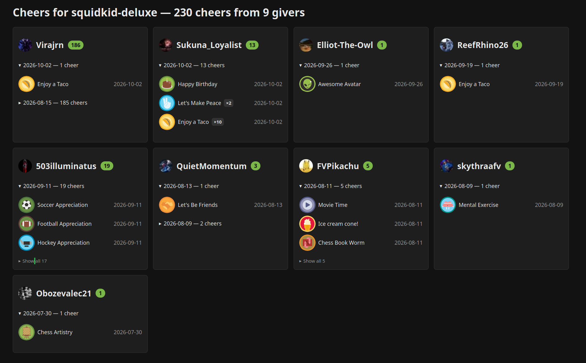

# Chess.com Cheers by Giver

A thank-you helper for chess.com cheers. It fetches every cheer a user has
received, groups them by giver, and renders a dark, static HTML page with
one card per giver — so you can see at a glance who cheered you recently
and what they sent.



Originally written up as a [suggestion for cheer organization on the
chess.com forums](https://www.chess.com/forum/view/site-feedback/suggestion-for-cheer-organization):
the profile Cheers/Awards section is organized by type, which makes it hard
to tell what each person gave you. This repurposes the same internal APIs to
organize by user instead.

## Why a script (CORS)

The chess.com endpoints used here send no `Access-Control-Allow-Origin`
header (and `OPTIONS` preflights get a `403` challenge), so a pure
browser-side page on another origin is blocked. This script fetches
server-side with Python and generates a self-contained HTML file instead.

## Usage

```bash
python3 cheers_by_user.py squidkid-deluxe
```

Writes `squidkid-deluxe-cheers.html` into the current directory (lowercased).
No third-party dependencies — stdlib only. A progress bar appears
automatically if [`tqdm`](https://github.com/tqdm/tqdm) is installed.

```bash
python3 cheers_by_user.py some-user --json out.json --html custom.html
python3 cheers_by_user.py some-user --no-html --no-progress
```

| Flag           | Effect                                              |
| -------------- | --------------------------------------------------- |
| `--html PATH`  | Write HTML to PATH instead of the default           |
| `--no-html`    | Skip HTML output                                    |
| `--json PATH`  | Also dump the grouped data as JSON                  |
| `--no-progress`| Silence the fetch progress bar                     |

## What the page shows

- **One card per giver**, ordered by most recent cheer (then most cheers,
  then A–Z), with avatar, name, and total-count badge
- **Smart date clusters**: cheers split into groups whenever the gap between
  consecutive cheers exceeds 3 days, so last week's gifts never mix with
  yesterday's; newest group expanded, older ones collapsed
- **×N collapsing**: repeats within a group become one row (`Enjoy a Taco
  ×10`); each group shows 3 rows with the rest behind a `Show all N` expander
- Dark theme, responsive grid (1 column narrow, auto-fill ≥900px, 70% width
  cap on wide screens), zero JavaScript

## How it works

1. `GET /callback/awards/<user>/community` → award types (`trophy_id`,
   `name`, `count`)
2. `GET /callback/user/trophy/<user>/<trophy_id>/0` per type → individual
   cheers (`from_user`, `trophy`, `create_date`, images)
3. Group by `from_user` → cluster by date → collapse repeats → render HTML

## Tests

```bash
python3 tests/test_cluster.py
python3 tests/test_render.py
python3 tests/test_group_sort.py
python3 tests/test_cli_default.py   # hits the live API
```
